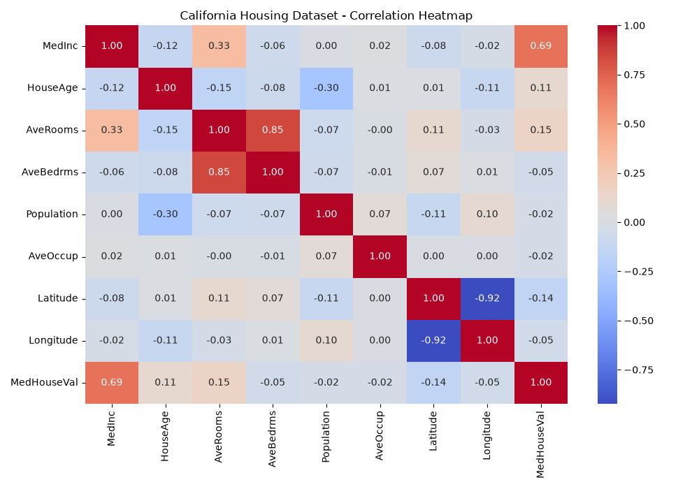
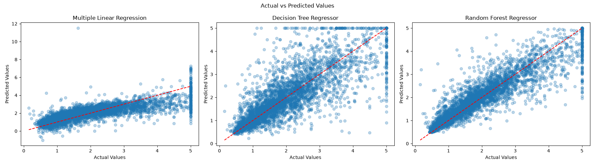
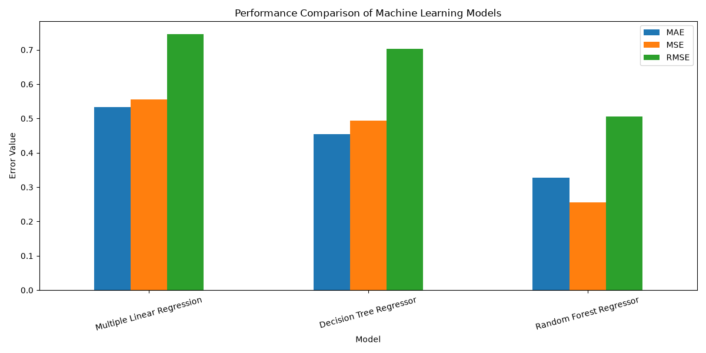
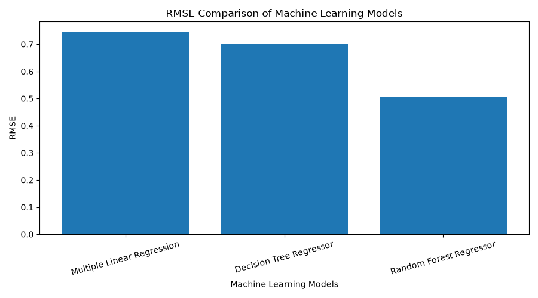

# Performance Analysis of Machine Learning Models

## Project Overview

This project compares the performance of three Machine Learning regression algorithms using the California Housing Dataset.

The main objective is to train, evaluate, and compare different regression models to identify the best-performing model based on standard evaluation metrics.

## Dataset

- Dataset: California Housing Dataset
- Total Records: 20,640
- Input Features: 8
- Target Variable: MedHouseVal
- Training Data: 80%
- Testing Data: 20%

## Machine Learning Algorithms

1. Multiple Linear Regression
2. Decision Tree Regressor
3. Random Forest Regressor

## Evaluation Metrics

The models are evaluated using:

- Mean Absolute Error (MAE)
- Mean Squared Error (MSE)
- Root Mean Squared Error (RMSE)
- R² Score

## Experimental Results

| Model | MAE | MSE | RMSE | R² Score |
|---|---:|---:|---:|---:|
| Multiple Linear Regression | 0.5332 | 0.5559 | 0.7456 | 0.5758 |
| Decision Tree Regressor | 0.4542 | 0.4943 | 0.7030 | 0.6228 |
| Random Forest Regressor | 0.3277 | 0.2560 | 0.5060 | 0.8046 |

## Result Analysis

Random Forest Regressor achieved the best performance among the three models.

It obtained an R² score of 0.8046, indicating that it explained approximately 80.46% of the variance in the test dataset.

It also achieved the lowest MAE and RMSE values.

## Visualizations

## Visualizations

### 1. Correlation Heatmap

### 2. Actual vs Predicted Values

### 3. Model Performance Comparison

### 4. RMSE Comparison

## Project Structure

    MiniProject/
    |
    |-- data/
    |   |-- california_housing.csv
    |
    |-- outputs/
    |   |-- actual_vs_predicted.png
    |   |-- correlation_heatmap.png
    |   |-- model_comparison.csv
    |   |-- model_comparison.png
    |   |-- rmse_comparison.png
    |
    |-- src/
    |   |-- main.py
    |
    |-- notebooks/
    |
    |-- README.md
    |-- requirements.txt
    |-- .gitignore

## Technologies Used

- Python
- NumPy
- Pandas
- Matplotlib
- Seaborn
- Scikit-learn
- Jupyter Notebook

## How to Run the Project

1. Clone the repository.
2. Install the required libraries:

       pip install -r requirements.txt

3. Run the Python program:

       python src/main.py

Note: The California Housing dataset is downloaded automatically when the program is run for the first time. An internet connection is required.

## Conclusion

This project demonstrates the application of different Machine Learning regression algorithms and their comparative performance.

Based on the experimental results, Random Forest Regressor performed better than Multiple Linear Regression and Decision Tree Regressor on the selected dataset.